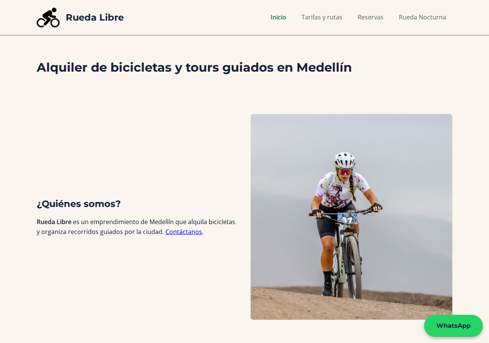
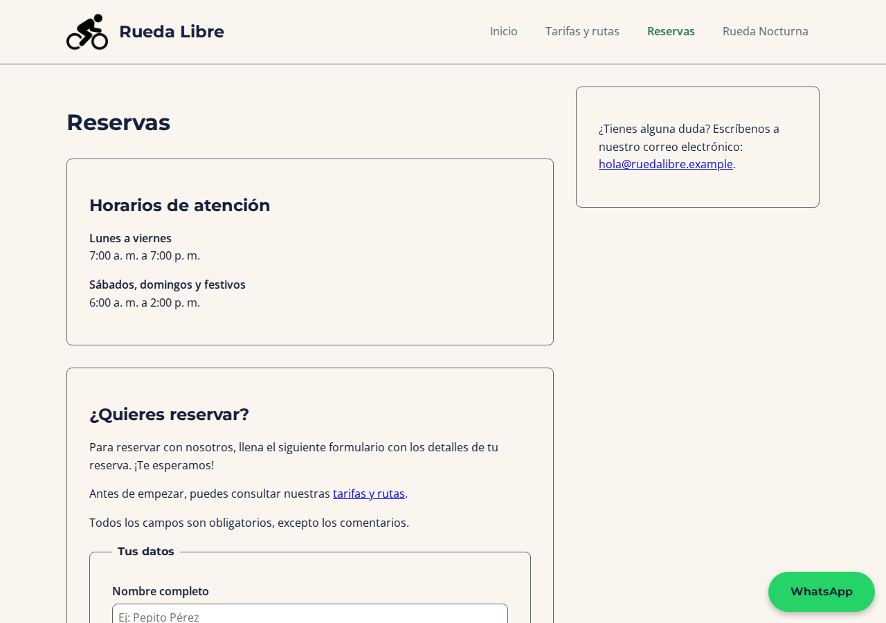
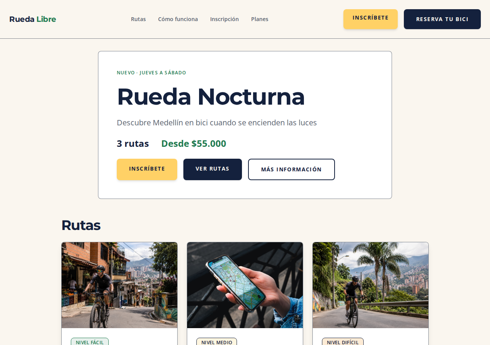
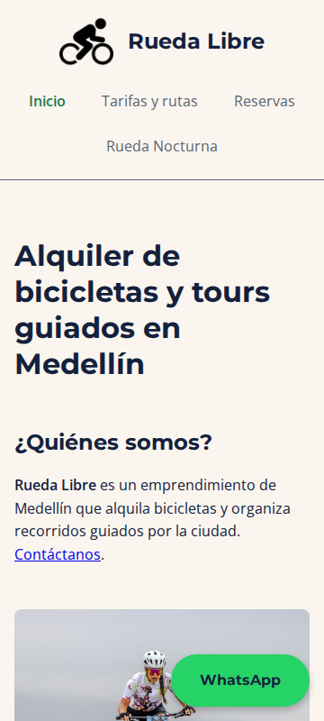
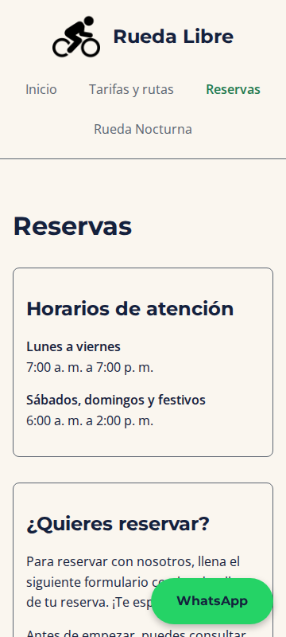
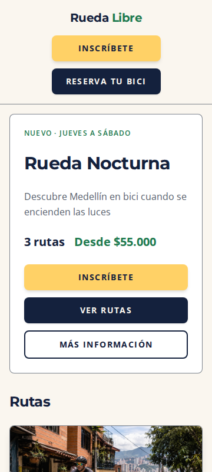
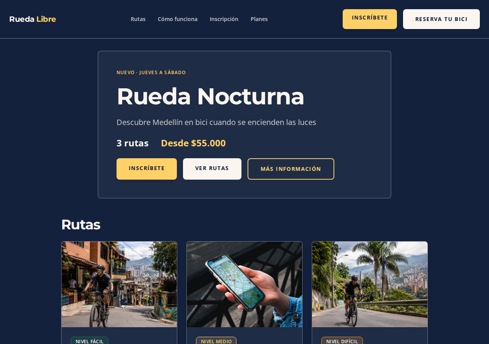

# Rueda Libre

Sitio web de alquiler de bicicletas y tours guiados en Medellín, desarrollado durante el **Riwi Basic Track**. El proyecto reúne dos productos:

- **Sitio principal**: páginas informativas y formulario de reservas con HTML5, CSS3 propio, diseño responsive y accesibilidad.
- **Rueda Nocturna**: landing de una experiencia nocturna construida con **Tailwind CSS 3.4**, con modo claro/oscuro automático, formulario de inscripción y sección de planes.

El trabajo se enfocó en estructura semántica, accesibilidad (texto alternativo, encabezados, contraste y teclado), validación nativa de formularios, diseño mobile-first y comparación de frameworks CSS.

## Enlaces publicados

El sitio se publica con GitHub Pages:

| Recurso | URL |
| --- | --- |
| Inicio | <https://juanpab53.github.io/Rueda-Libre/> |
| Tarifas y rutas | <https://juanpab53.github.io/Rueda-Libre/pages/tarifas.html> |
| Reservas | <https://juanpab53.github.io/Rueda-Libre/pages/reservas.html> |
| Landing Rueda Nocturna | <https://juanpab53.github.io/Rueda-Libre/nocturna/> |
| Kit de componentes | <https://juanpab53.github.io/Rueda-Libre/nocturna/componentes.html> |
| Prototipo Tailwind (Play CDN) | <https://juanpab53.github.io/Rueda-Libre/nocturna/prototipo.html> |
| Prueba comparativa con Bootstrap | <https://juanpab53.github.io/Rueda-Libre/pruebas/catalogo-bootstrap.html> |
| Repositorio | <https://github.com/juanpab53/Rueda-Libre> |

## Páginas

| Página | Archivo | Descripción |
| --- | --- | --- |
| Inicio | `index.html` | Presentación, rutas, servicios, tipos de bicicleta, flota, pasos para alquilar, beneficios y contacto. |
| Tarifas y rutas | `pages/tarifas.html` | Tablas de precios de alquiler y tours, horarios de salida y recomendaciones. |
| Reservas | `pages/reservas.html` | Formulario de reserva con validación HTML5, horarios de atención y contacto. |
| Rueda Nocturna | `nocturna/index.html` | Landing responsive con rutas, pasos, planes, formulario de inscripción y modo oscuro. |
| Kit de componentes | `nocturna/componentes.html` | Botones, card de ruta, alertas y campos de formulario con las reglas del kit. |
| Prototipo | `nocturna/prototipo.html` | Primera versión de la sección principal usando Tailwind Play CDN. |
| Prueba Bootstrap | `pruebas/catalogo-bootstrap.html` | Comparación de la flota con la grilla y las tarjetas de Bootstrap 5.3. |

## Capturas

Capturas del sitio actual en escritorio, celular y modo oscuro. Las imágenes están en [`docs/capturas/`](docs/capturas/).

### Escritorio (1280 × 900 px)

| Inicio | Reservas | Rueda Nocturna |
| --- | --- | --- |
|  |  |  |

### Celular (360 × 800 px)

| Inicio | Reservas | Rueda Nocturna |
| --- | --- | --- |
|  |  |  |

### Modo oscuro

La landing usa `prefers-color-scheme: dark` para adaptar fondos, textos, campos y focos.



## Tecnologías

- **HTML5 semántico**: `header`, `nav`, `main`, `section`, `article`, `aside`, `footer`, listas de descripción y tablas con `caption` y `scope`.
- **CSS3 propio** (`css/styles.css`): variables de diseño, Grid, Flexbox, unidades `rem`, `%` y `vh`, enfoque mobile-first y breakpoints en `768px` y `1200px`.
- **Tailwind CSS 3.4.19** (`nocturna/`): utilidades, CLI, configuración de marca en `tailwind.config.js`, `darkMode: 'media'` y hoja compilada y minificada.
- **Bootstrap 5.3** (solo en `pruebas/`): comparación de grilla, tarjetas y botones frente al CSS propio.
- **Validación nativa HTML5**: `required`, `minlength`, `maxlength`, `pattern`, `type`, `min`, `max` y `step`. No hay JavaScript propio en producción.
- **Google Fonts**: Montserrat para títulos y Open Sans para texto general.
- **GitHub Actions + GitHub Pages**: publicación automática al integrar cambios en `main`.
- **npm**: únicamente para compilar Tailwind en `nocturna/`.
- **Playwright + Chromium**: verificación de responsive, formularios, modo oscuro y generación de las capturas del README.

## Estructura del repositorio

```text
.
├── index.html                    # Inicio
├── css/
│   └── styles.css                # Estilos propios del sitio principal
├── img/                          # Imágenes del sitio
├── pages/
│   ├── tarifas.html              # Tarifas y rutas
│   └── reservas.html             # Formulario de reservas
├── nocturna/
│   ├── index.html                # Landing Rueda Nocturna
│   ├── componentes.html          # Kit de componentes
│   ├── prototipo.html            # Prototipo con Play CDN
│   ├── src/
│   │   ├── input.css             # Directivas de Tailwind
│   │   └── output.css            # CSS compilado y minificado (versionado)
│   ├── tailwind.config.js
│   ├── package.json
│   └── .gitignore
├── pruebas/
│   └── catalogo-bootstrap.html   # Comparación con Bootstrap
├── docs/
│   └── capturas/                 # Capturas del README (escritorio, celular y oscuro)
├── bitacora.txt                  # Bitácora original del proceso
├── .github/workflows/static.yml  # Despliegue a GitHub Pages
└── README.md
```

## Lista de verificación final

| Criterio | Resultado | Evidencia |
| --- | --- | --- |
| Estructura semántica | Cumple | Regiones `header`, `nav`, `main`, `section`, `article`, `aside` y `footer`; un solo `h1` por página y jerarquía de encabezados sin saltos. |
| Texto alternativo | Cumple | Todas las imágenes tienen `alt`; las decorativas usan `alt=""`. Se corrigieron los textos repetidos de la flota. |
| Encabezados | Cumple | Un `h1` por página; secciones con `h2` y tarjetas con `h3`. |
| Contraste | Cumple AA/AAA | Azul Noche/Crema 14.83:1; Gris Asfalto/Crema 5.57:1; Verde Ruta/Crema 4.93:1; Azul Noche/Amarillo Farol 11.08:1. Naranja Pedal no se usa para texto corrido. |
| Teclado y foco | Cumple | Enlace "Saltar al contenido", foco visible con anillo/outline en enlaces, botones y campos; orden de tabulación lógico. |
| Formularios validados | Cumple | Reservas y Nocturna usan restricciones HTML5; 8 pruebas documentadas (campos vacíos, longitudes, patrones, correo, fecha, checkbox y envío válido). |
| Responsive | Cumple | Probado a 360, 768 y 1280 px sin scroll horizontal. |
| Modo claro y oscuro | Cumple en la landing | `prefers-color-scheme` verificado: fondo `#14213d` y texto `#faf6ef` en oscuro; campos y focos adaptados. El sitio principal mantiene modo claro por diseño. |
| Cero errores 404 | Cumple | Todos los enlaces, anclas e imágenes locales resuelven; las páginas publicadas responden `200`. |
| Sin estilos en línea | Cumple | `0` atributos `style` y `0` bloques `<style>` en las páginas del proyecto. |
| Capturas documentadas | Cumple | 7 capturas en `docs/capturas/`: escritorio, celular y modo oscuro. |
| `output.css` minificado | Cumple | Compilado con `--minify` y versionado en el repositorio (20.377 bytes). |
| Validación W3C | Cumple | 0 errores y 0 mensajes en la landing, Reservas, Inicio, Tarifas y Kit de componentes con el validador Nu de W3C. |

### Responsive verificado

Medición con navegador headless a 360, 768 y 1280 px:

| Viewport | Inicio (portada / rutas / flota) | Reservas (documento y celular) | Nocturna (rutas / pasos / planes) | Scroll horizontal |
| --- | --- | --- | --- | --- |
| 360 px | 1 / 1 / 1 columna | Campos apilados | 1 / 1 / 1 columna | No |
| 768 px | 2 / 3 / 2 columnas | Campos en fila | 2 / 2 / 1 columna | No |
| 1280 px | 2 / 3 / 3 columnas | Campos en fila | 3 / 4 / 3 columnas | No |

### Validación W3C

Se validaron las páginas con el **Nu HTML Checker** de W3C:

- `nocturna/index.html`: 0 mensajes.
- `pages/reservas.html`: 0 mensajes.
- `index.html`, `pages/tarifas.html` y `nocturna/componentes.html`: 0 mensajes.

Correcciones aplicadas en Reservas: se eliminó el `action=""`, se cambió `autocomplete="tel-national"` por `autocomplete="tel"` y se agregaron opciones iniciales vacías a los `select` obligatorios. También se retiraron las barras finales de los elementos vacíos (`/>` → `>`) para dejar el documento sin avisos.

## Bitácora resumida

La bitácora completa está en [`bitacora.txt`](bitacora.txt). Estos fueron los hitos principales:

1. **Punto de partida HTTP**: se documentaron URL, método, código `200` y el comportamiento ante una ruta inexistente.
2. **Estructura y regiones**: se definieron las páginas, sus secciones y la navegación entre Inicio, Tarifas y Reservas.
3. **Controles del formulario**: texto para nombre, `email` para correo, listas para catálogos cerrados, área de texto para comentarios y casilla obligatoria para políticas.
4. **Pruebas de validación**: se registraron 8 escenarios; 6 bloqueos por restricciones, 1 envío válido y 1 bloqueo por checkbox sin marcar.
5. **Contraste WCAG**: se midió la paleta y se excluyó Naranja Pedal del texto corrido por su baja relación (2.05:1 sobre Crema).
6. **Especificidad**: se resolvió el conflicto del menú con `[aria-current="page"]` y sin `!important`.
7. **Modelo de caja**: se verificó `box-sizing: border-box` y la diferencia entre `content-box` y `border-box`.
8. **Layout bidimensional**: Grid para portada, rutas y reservas; Flexbox para encabezado, pie y fila de campos.
9. **Mobile-first**: base de una columna y ampliación en `768px` y `1200px`.
10. **Problemas responsive resueltos**: columnas prematuras en móvil, tablas con desplazamiento lateral, campos angostos, portada a `60vh` y un enlace con ruta absoluta que producía 404 en Pages.
11. **Comparación con Bootstrap**: se midió el costo en HTML, CSS y pérdida de identidad visual frente al CSS propio.
12. **Tailwind**: prototipo con Play CDN, proyecto con CLI, kit de componentes y reemplazo de colores genéricos por la paleta de marca.
13. **Marca y modo oscuro**: configuración de tokens, tipografías y variantes `dark:` con `darkMode: 'media'`.
14. **Landing Nocturna**: secciones de rutas, pasos, planes y formulario de inscripción; ajustes de responsive y foco visible.
15. **Cierre**: validación W3C, revisión de enlaces, accesibilidad, responsive y compilación minificada de `output.css`.

## Aprendizajes

1. **El HTML semántico ordena el proyecto antes que el CSS.** Usar regiones (`header`, `nav`, `main`, `section`, `article`, `aside`, `footer`) y un solo `h1` por página facilitó la navegación, la validación y la lectura con lector de pantalla.
2. **La accesibilidad se construye desde el marcado.** Texto alternativo útil, etiquetas asociadas, `aria-describedby`, enlace de salto y foco visible resolvieron la mayor parte sin JavaScript.
3. **El contraste no se improvisa.** Medir la paleta permitió reservar Naranja Pedal para botones y descartarlo para texto corrido; las combinaciones usadas cumplen AA/AAA.
4. **La validación nativa cubre el caso base.** `required`, `pattern`, `minlength`, `type` y los rangos de fecha bloquearon los envíos inválidos y dieron mensajes claros sin código adicional.
5. **Mobile-first exige probar, no solo escribir media queries.** A 360 px aparecieron columnas prematuras, tablas que se desbordaban y campos angostos; medir en 360, 768 y 1280 px confirmó las correcciones.
6. **El modelo de caja y la especificidad explican muchos bugs.** `box-sizing: border-box` evitó desbordes y `[aria-current="page"]` resolvió el estado activo del menú sin `!important`.
7. **Cada framework tiene un costo.** Bootstrap acelera la grilla y obliga a sobrescribir la identidad; Tailwind dio control y un CSS final de 20 KB, a cambio de más clases en el HTML.
8. **El modo oscuro y la validación W3C.** `prefers-color-scheme` con tokens de marca mantuvo la legibilidad, y el validador Nu permitió dejar las páginas en cero errores.

## Recomendación de framework

**Recomendación principal: Tailwind CSS** para el desarrollo de nuevas páginas y para unificar el proyecto a mediano plazo.

Razones:

- La identidad de marca queda centralizada en `tailwind.config.js` (colores y tipografías), sin repetir valores hexadecimales.
- El modo oscuro se resuelve con `darkMode: 'media'` y variantes `dark:` sin JavaScript adicional.
- El enfoque mobile-first y los breakpoints de Tailwind cubren con claridad los tres anchos evaluados.
- El CSS final se genera solo con las clases usadas y se minifica: la landing completa pesa **20.377 bytes**, frente a los **232.000 bytes** de Bootstrap usados en la prueba comparativa.
- Los estados de foco, hover y contraste se controlan de forma explícita, lo que facilita cumplir WCAG.

**Cuándo no usar Tailwind**: si el equipo necesita componentes cerrados sin build step y no va a personalizar la identidad visual, Bootstrap sigue siendo una opción rápida. Para este proyecto no se recomienda en producción porque obliga a sobrescribir estilos para recuperar la paleta y aumenta el peso de la página.

**Sitio principal**: se puede conservar el CSS propio porque ya es estable, ligero y accesible; para nuevas páginas conviene usar Tailwind y, si se busca una sola base de estilos, migrar gradualmente el sitio principal.

**Si el proyecto crece** a reservas reales con backend, autenticación o contenido dinámico, la siguiente etapa recomendada es **Astro + Tailwind** (sitio estático rápido, componentes reutilizables y carga selectiva de JavaScript). Si se requiere renderizado en servidor o una API integrada, **Next.js + Tailwind** es la alternativa natural.

## Cómo ejecutar el sitio

1. Clona el repositorio:

   ```bash
   git clone https://github.com/juanpab53/Rueda-Libre.git
   ```

2. Abre `index.html` en el navegador o sirve la raíz del proyecto:

   ```bash
   python3 -m http.server 8000
   ```

3. Visita `http://localhost:8000/`.

La landing ya incluye `nocturna/src/output.css`, por lo que no necesita compilación para visualizarse.

## Cómo recompilar Tailwind

```bash
cd nocturna
npm install
npx tailwindcss -i ./src/input.css -o ./src/output.css --minify
```

Durante el desarrollo se puede usar `--watch` en lugar de `--minify`. El archivo `output.css` se versiona porque GitHub Pages no ejecuta npm ni la CLI de Tailwind.

## Despliegue

El workflow `.github/workflows/static.yml` publica todo el repositorio en **GitHub Pages** cuando se hace push a `main` y también puede ejecutarse manualmente desde la pestaña **Actions**. Por eso, cualquier cambio en `output.css` debe quedar commiteado antes de integrar la rama.

---

**Desarrollado por [Juan Pablo Aparicio](https://github.com/juanpab53)**

Riwi · Basic Track · 2026
